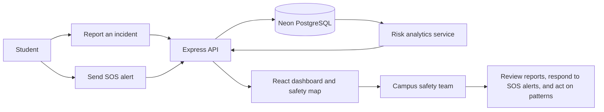
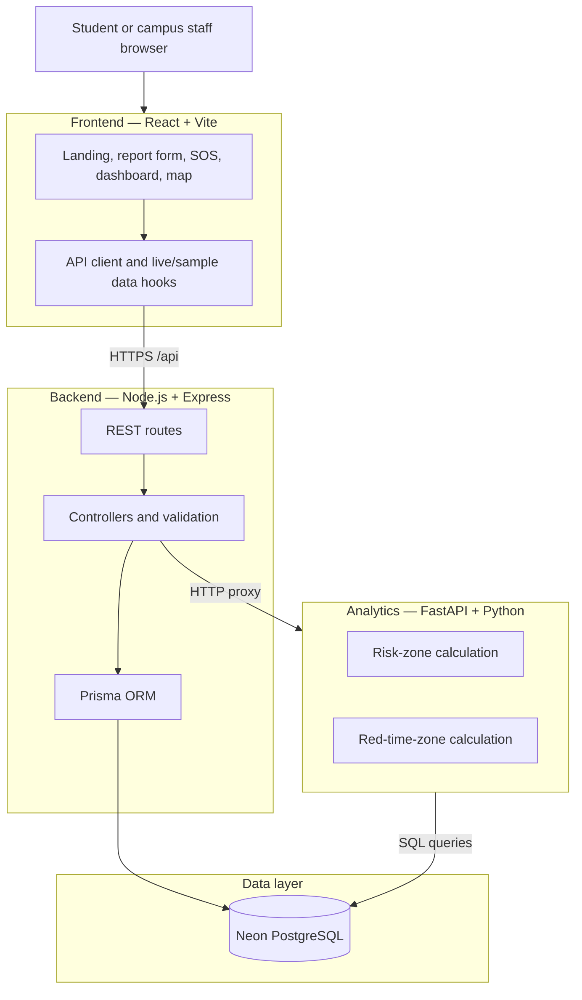
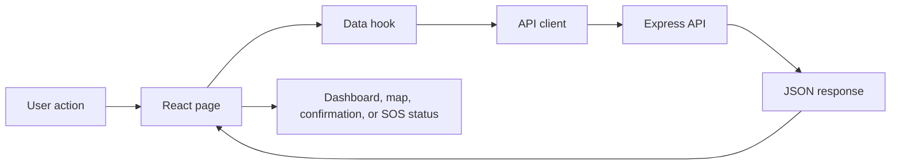
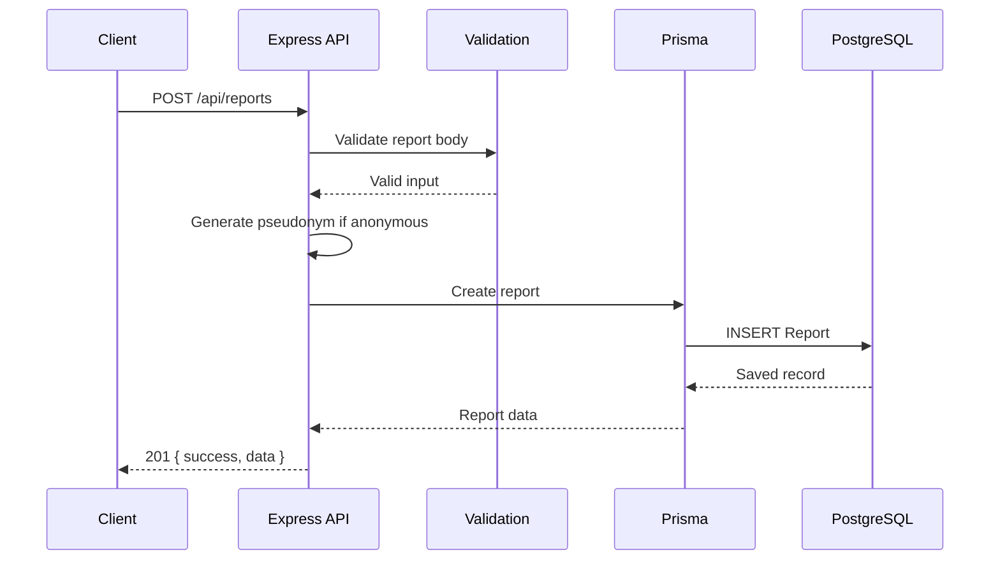
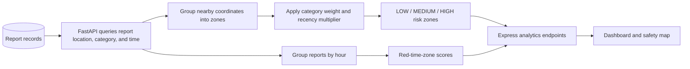
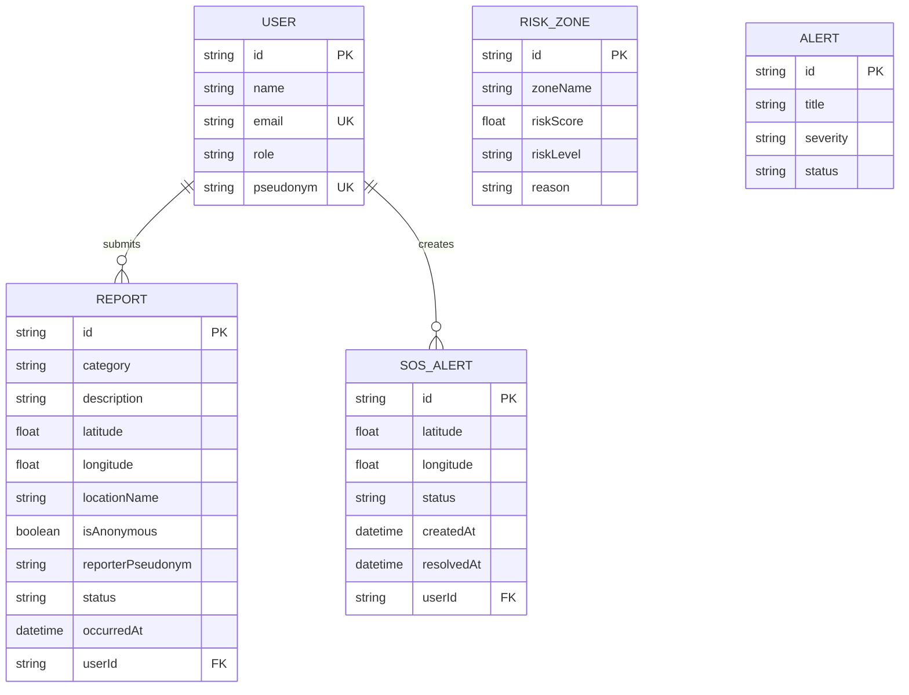
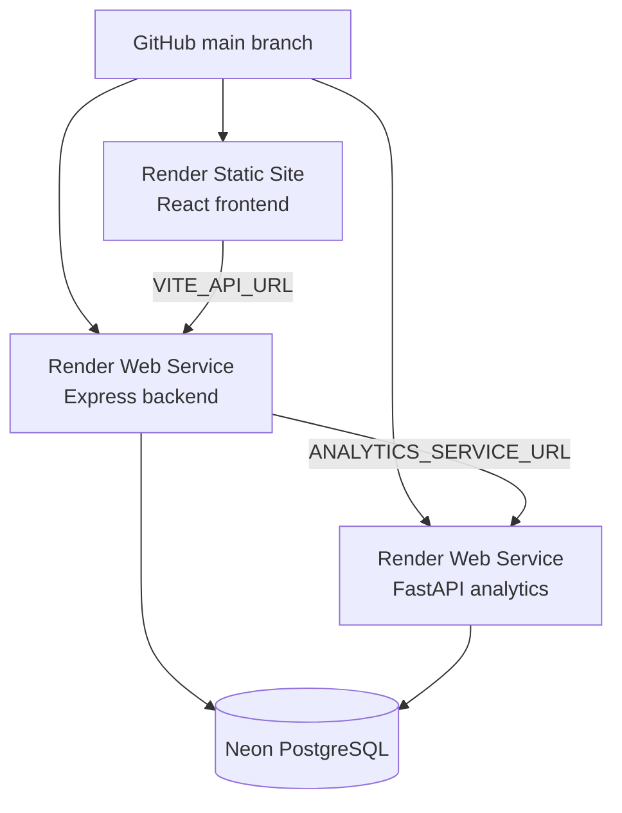

# SafeCampus

> A community-based reporting and monitoring platform that helps colleges identify safety concerns early, respond to SOS alerts, and spot recurring risk areas on campus.

[](https://campus-safety-zwed.onrender.com)
[](https://campus-safety-api.onrender.com/api/health)
[](https://campus-safety-analytics.onrender.com/health)

## Live demo

| Service | Link |
| --- | --- |
| SafeCampus web app | [campus-safety-zwed.onrender.com](https://campus-safety-zwed.onrender.com) |
| Backend health check | [campus-safety-api.onrender.com/api/health](https://campus-safety-api.onrender.com/api/health) |
| Analytics health check | [campus-safety-analytics.onrender.com/health](https://campus-safety-analytics.onrender.com/health) |

> **Note:** The services use Render's free tier. The first request after inactivity can take a short time while the service wakes up.

---

## The problem

Students may avoid reporting safety concerns because reporting feels slow, intimidating, or unsafe. As a result, smaller warning signs—such as poor lighting, unsafe pathways, harassment, or stalking—can remain invisible until they become serious incidents.

SafeCampus creates one simple place where students can report a concern anonymously, trigger an SOS alert in an emergency, and see aggregated campus-safety information. The platform turns individual reports into useful patterns for the safety team: recurring black spots, high-risk areas, and hours when incidents are more common.

## What SafeCampus does

- Lets students submit structured safety reports, anonymously by default.
- Generates a friendly pseudonym for anonymous reporters instead of storing their identity.
- Captures SOS alerts with the student's location and tracks their status.
- Provides a live admin dashboard for report counts, SOS activity, categories, recent reports, and black spots.
- Maps reports and live analytics-based risk zones on a campus map.
- Analyses report location, category, recency, and time of day to identify risk zones and red-time zones.

---

## Product flow



---

## Core features

| Area | What is included |
| --- | --- |
| Incident reporting | Category, description, campus location, coordinates, date/time, validation, anonymous mode, and confirmation reference |
| Anonymous reporting | Random pseudonyms such as `KindRiver5224`; anonymous reports are not linked to a user account |
| SOS alerts | Create, list, acknowledge, and resolve location-based emergency alerts |
| Admin dashboard | Live totals, open/resolved reports, SOS status, category split, recent reports, black spots, risk zones, and red-time zones |
| Safety map | Campus boundary, report markers, category filters, risk-zone layer, black-spot list, and report details |
| Analytics | Risk scoring by location/category/recency and incident clustering by hour |
| Deployment | Frontend, API, analytics, and PostgreSQL database are available online |

---

## Architecture



### Frontend flow



The frontend uses **React**, **Vite**, **Tailwind CSS**, **glassform**, and **Lucide** icons. It provides the landing page, incident form, SOS experience, responsive dashboard, and interactive campus map. In development, Vite proxies `/api` requests to the backend. In production, `VITE_API_URL` points to the deployed API.

### Backend flow



The backend is an **Express** API with request validation, Helmet security headers, CORS configuration, logging, Prisma integration, and consistent JSON responses.

### Analytics flow



The analytics service uses **FastAPI** and **psycopg**. It reads report data from PostgreSQL and returns two small, focused datasets:

- **Risk zones:** nearby report locations grouped and scored with category severity and recency.
- **Red-time zones:** reports grouped by the hour at which they occurred.

---

## Technology stack

| Layer | Technologies |
| --- | --- |
| Frontend | React 19, Vite, Tailwind CSS 4, React Router, glassform, Lucide |
| Backend | Node.js, Express, Prisma, Helmet, CORS, Morgan |
| Database | PostgreSQL on Neon |
| Analytics | Python, FastAPI, Uvicorn, psycopg |
| Mapping | OpenStreetMap tiles and custom SVG/Web Mercator rendering |
| Deployment | Render |

---

## Repository structure

```text
women-safety-campus-tool/
├── frontend/                 # React user interface
│   ├── src/pages/            # Landing, dashboard, report, map, SOS pages
│   ├── src/components/       # Reusable UI components
│   ├── src/hooks/            # Data, form, geolocation, and theme hooks
│   ├── src/lib/              # API client, map geometry, and statistics helpers
│   └── src/data/             # Categories, campus places, and sample fallback data
├── backend/                  # Express REST API
│   ├── prisma/               # Prisma schema and SQL migrations
│   └── src/
│       ├── controllers/      # Report, SOS, dashboard, and analytics logic
│       ├── middleware/       # Validation and error handling
│       ├── routes/           # API route definitions
│       └── db/               # Prisma client
└── analytics/                # FastAPI risk-analysis service
    ├── main.py
    └── requirements.txt
```

---

## API reference

All backend responses follow this shape:

```json
{
  "success": true,
  "data": {}
}
```

| Method | Endpoint | Purpose |
| --- | --- | --- |
| `GET` | `/api/health` | API status and timestamp |
| `GET` | `/api/reports` | List saved reports, newest first |
| `POST` | `/api/reports` | Submit a validated safety report |
| `GET` | `/api/sos-alerts` | List SOS alerts; supports an optional `status` query |
| `POST` | `/api/sos-alerts` | Create a location-based SOS alert |
| `PATCH` | `/api/sos-alerts/:id/acknowledge` | Mark an SOS alert as acknowledged |
| `PATCH` | `/api/sos-alerts/:id/resolve` | Resolve an SOS alert and record the resolution time |
| `GET` | `/api/dashboard/summary` | Dashboard summary of reports, SOS status, and recent reports |
| `GET` | `/api/analytics/risk-zones` | Proxy live risk zones from the analytics service |
| `GET` | `/api/analytics/red-time-zones` | Proxy live red-time-zone data from the analytics service |

### Example: create an anonymous report

```bash
curl -X POST http://localhost:4000/api/reports \
  -H "Content-Type: application/json" \
  -d '{
    "category": "UNSAFE_AREA",
    "description": "Street lights near the sports ground are not working after 8 PM.",
    "location": {
      "name": "Sports Ground",
      "latitude": 18.6215,
      "longitude": 73.9108
    },
    "isAnonymous": true
  }'
```

---

## Database model



The Prisma schema includes `User`, `Report`, `SOSAlert`, `RiskZone`, and `Alert` models. Coordinate, report-status, and timestamp indexes support dashboard and analytics queries.

---

## Run locally

### Prerequisites

- Node.js 20+ recommended
- Python 3.10+
- A PostgreSQL database (Neon or local PostgreSQL)

### 1. Clone the project

```bash
git clone https://github.com/Amrisha-Aashish/women-safety-campus-tool.git
cd women-safety-campus-tool
```

### 2. Set up the backend

```bash
cd backend
cp .env.example .env
npm install
npm run db:generate
npm run db:deploy
npm run dev
```

Set these values in `backend/.env` before starting:

```env
PORT=4000
CLIENT_ORIGIN=http://localhost:5173
NODE_ENV=development
DATABASE_URL=postgresql://...
ANALYTICS_SERVICE_URL=http://127.0.0.1:8000
```

### 3. Set up analytics

Open a second terminal:

```bash
cd analytics
python3 -m venv .venv
source .venv/bin/activate
pip install -r requirements.txt
```

Create `analytics/.env` and add the same PostgreSQL connection string:

```env
DATABASE_URL=postgresql://...
```

Start the analytics service:

```bash
python -m uvicorn main:app --reload --port 8000
```

### 4. Set up the frontend

Open a third terminal:

```bash
cd frontend
npm install
npm run dev
```

Open [http://localhost:5173](http://localhost:5173).

For a deployed frontend, create `frontend/.env`:

```env
VITE_API_URL=https://your-api-domain.example
```

---

## Environment variables

| Location | Variable | Required | Purpose |
| --- | --- | --- | --- |
| `backend/.env` | `DATABASE_URL` | Yes | PostgreSQL connection string |
| `backend/.env` | `ANALYTICS_SERVICE_URL` | Yes for analytics | URL of the FastAPI service |
| `backend/.env` | `CLIENT_ORIGIN` | Yes in production | Allowed frontend origin for CORS |
| `backend/.env` | `PORT` | No | API port; defaults to `4000` locally |
| `backend/.env` | `NODE_ENV` | No | Runtime environment |
| `analytics/.env` | `DATABASE_URL` | Yes | PostgreSQL connection string used for analysis |
| `frontend/.env` | `VITE_API_URL` | Yes in production | Public API base URL embedded at build time |

**Never commit `.env` files or real database credentials.** Use `.env.example` as a safe template.

---

## Deployment design



### Render settings used

| Service | Root directory | Build command | Start / publish setting |
| --- | --- | --- | --- |
| Frontend static site | `frontend` | `npm ci && npm run build` | Publish directory: `dist` |
| Backend web service | `backend` | `npm ci && npx prisma generate` | `npm start` |
| Analytics web service | `analytics` | `pip install -r requirements.txt` | `uvicorn main:app --host 0.0.0.0 --port $PORT` |

For React Router on Render, add this **Rewrite** rule to the static site so direct links such as `/dashboard` and `/map` work:

| Source | Destination | Action |
| --- | --- | --- |
| `/*` | `/index.html` | Rewrite |

---

## Privacy and current scope

- Anonymous reports are the default and receive a generated pseudonym.
- The platform stores the report details and location needed to identify campus-safety patterns.
- Authentication is **not implemented yet**. Submitting a non-anonymous report therefore requires a future authentication layer.
- Campus security contact numbers and institution-specific response procedures should be configured before a real-world rollout.
- This project is a prototype for reporting and awareness; it does not replace emergency services.

---

## Future improvements

- Role-based authentication for students, security staff, and administrators.
- Secure report-status updates and assignee workflow.
- Notifications through email, SMS, or push alerts.
- A dedicated endpoint for one SOS alert and better location-sharing status.
- Persistent risk-zone history and configurable analytics scoring.
- Verified emergency contacts and escalation rules for each campus.
- Automated tests, CI, and audit logging.

---

## Team

| Member | Contribution |
| --- | --- |
| **Amrisha Aashish** | Backend API, integrations, deployment, and project coordination |
| **Shreya Singh** | PostgreSQL/Prisma database work and risk analytics service |
| **Satyashri** | React frontend UI, dashboard, report flow, SOS experience, and campus map |

---

## License

This project is licensed under the [MIT License](LICENSE).
